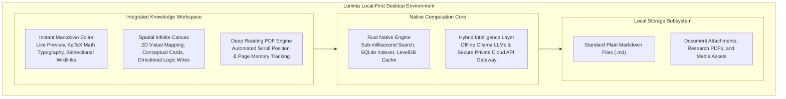
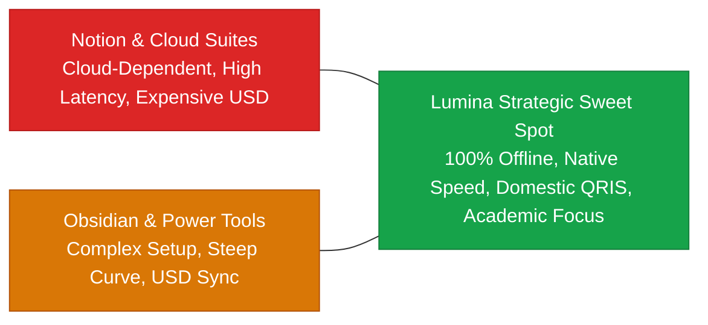
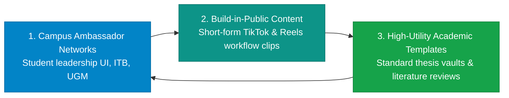
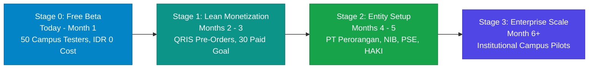

# Lumina: Strategic Business Report & Operational Project Plan

**Enterprise:** Lumina Technologies
**Product:** Lumina Knowledge Workspace
**Primary Market:** Republic of Indonesia
**Sector:** Personal Knowledge Management (PKM) & Desktop Productivity SaaS
**Document Classification:** Formal Business Plan & Comprehensive Strategic Report
**Language:** English | **Target Length:** 2,000+ Words

---

## 1. Executive Summary & Corporate Vision

Lumina is an offline-first desktop knowledge operating system engineered to provide students, academic researchers, and digital professionals with an ultra-fast, privacy-preserving workspace. Over the past decade, enterprise and consumer productivity software has migrated almost exclusively into centralized cloud architectures. While this cloud transition has simplified collaborative real-time editing, it has introduced severe compromises for individuals engaged in deep, rigorous cognitive work. Modern knowledge workers find themselves constrained by proprietary cloud platforms where documents require continuous internet access, user interfaces lag under heavy loads, and personal research archives remain vulnerable to subscription price hikes and foreign currency volatility.

The foundational thesis of Lumina is to establish a dominant domestic knowledge operating system within Indonesia by adopting a local-first engineering philosophy. In a local-first system, all documents, visual diagrams, and research notes are stored as open-standard plain Markdown files directly on the user's personal hardware. This architecture guarantees that data remains entirely under the ownership of the user, operates at native computer speeds with zero loading spinners, and functions continuously regardless of whether an active network connection exists. Notes composed within Lumina are permanent assets that will remain readable decades into the future on any computer, independent of the corporate longevity of any specific software vendor.

Lumina brings together four core cognitive activities that have traditionally required separate software tools: structured Markdown document writing, spatial infinite canvas mapping, academic PDF reading with persistent memory tracking, and private artificial intelligence assistance. Operating on a transparent freemium commercial model, Lumina provides an essential free tier for local writing and visual thinking, while offering a paid subscription for end-to-end encrypted cloud backup and multi-device synchronization. By integrating domestic payment infrastructure, Lumina enables frictionless checkout using dynamic QRIS and Indonesian digital wallets, establishing an accessible and highly defensible business model tailored to Southeast Asia's largest digital economy.

---

## 2. Macroeconomic and Market Analysis: The Indonesian Landscape

The productivity software market within Indonesia represents an exceptional and largely untapped commercial frontier. Driven by an expanding youth demographic, widespread mobile internet penetration, and massive investments in higher education, Indonesia is experiencing an unprecedented surge in digital knowledge generation. Across the archipelago, there are currently more than 9.3 million students enrolled in higher education institutions and over 4.5 million digital knowledge professionals, including software developers, UX designers, legal researchers, corporate consultants, and creative agency specialists.

Despite this rapid digitization, the domestic software landscape remains heavily dependent on foreign software platforms conceived and priced for Western economies. Silicon Valley productivity platforms operate on corporate pricing tiers that assume high purchasing power and continuous gigabit fiber-optic connectivity. In Indonesia, where macroeconomic realities differ significantly, these platforms create acute consumer friction. Provincial minimum wages across Indonesia range from two and a half million to five million rupiah per month. In this economic context, paying between eighty-five thousand and two hundred and forty-five thousand rupiah every single month for a note-taking application is an unjustifiable expense for undergraduate students and early-career freelancers.

Furthermore, domestic digital infrastructure presents substantial geographic variability. While prime commercial districts in Jakarta, Surabaya, and Bandung enjoy reliable high-speed broadband, university campuses, suburban transit corridors, and regional universities frequently suffer from intermittent connectivity, high packet loss, and frequent cellular data disruptions. Knowledge workers who commute on public transit or conduct field research in regional areas encounter continuous workflow interruptions when relying on cloud-dependent applications. When a cloud-first application loses connection, synchronization stalls, document edits risk being overwritten, and interfaces become unresponsive. The Indonesian market demands an architecture that treats offline functionality not as an occasional fallback, but as the foundational operating state.

---

## 3. Core Problem Statement: Fragmented Workflows and Prohibitive Foreign Pricing

The operational challenges confronting Indonesian students and digital professionals are concentrated into three primary structural failures: economic exclusion, tool fragmentation, and data sovereignty risks.

Economic exclusion occurs because global productivity leaders demand payment exclusively in US dollars through international credit cards or PayPal. Over eighty percent of university students and independent workers in Indonesia do not possess an international credit card. Consequently, even students willing to pay for premium software subscriptions are systematically locked out by foreign payment processors. Those who do subscribe face monthly foreign exchange volatility, where currency fluctuations arbitrarily increase the cost of their academic tools.

Tool fragmentation represents the single greatest drain on cognitive productivity in higher education. A student preparing an undergraduate thesis (*skripsi*) or a master's thesis (*tesis*) is forced to navigate between four and five isolated desktop applications simultaneously. They open a web browser containing dozens of academic journal tabs, a standalone PDF reader to view literature, Microsoft Word to type drafts, an external diagramming tool to sketch theoretical frameworks, and a browser portal to interact with public artificial intelligence. This fragmented workflow induces constant context-switching, overwhelms computer system memory, and scatters research materials across multiple unorganized directories.

Data sovereignty and privacy concerns have become increasingly urgent following the formal enactment of Indonesia's Personal Data Protection Law (UU No. 27/2022). Students conducting proprietary scientific research, consultants handling sensitive client contracts, and academics preparing unpublished manuscripts are routinely storing confidential intellectual property on overseas cloud databases without transparent privacy guarantees. Users face the continuous risk of vendor lock-in, unexpected account suspensions, and corporate policy changes that can restrict access to their personal research archives.

---

## 4. Product Architecture and Local-First Engineering

Lumina resolves these systemic problems by unifying writing, spatial thinking, deep document reading, and private artificial intelligence into a cohesive desktop application powered by an integrated Rust computational core.



The writing interface is anchored around an instant Markdown engine that provides live formatting, bidirectional wikilinking, and mathematical typesetting via KaTeX. Because indexing is computed locally using a high-performance SQLite engine, full-text searches across vaults containing tens of thousands of notes execute in single-digit milliseconds. Users can interlink notes seamlessly, creating an interconnected personal knowledge graph that reflects their cognitive thought process.

Directly beside the editor is the spatial infinite canvas. Recognizing that complex intellectual models require visual and spatial arrangement, the canvas allows users to drag note cards, reference excerpts, and images onto an expansive two-dimensional grid. Conceptual relationships are visualized through directional connection wires, enabling researchers to map structural chapters, thesis arguments, and systems architecture side-by-side with their written text.

Lumina’s deep reading PDF environment is engineered specifically for academic literature review. Rather than forcing the researcher to switch back and forth between an external reader and their notes, Lumina displays PDF documents side-by-side with the active Markdown writing pane. Most importantly, the engine incorporates an automated reading memory algorithm: whenever a user closes the application, Lumina captures the exact page number, zoom level, and scroll coordinate of every open PDF. Upon relaunch, the application restores the document to the precise sentence where the user paused, eliminating the frustration of hunting through lengthy documents.

The intelligence layer is designed around absolute privacy and local compute efficiency. Users can run language models completely offline on their personal hardware via Ollama, generating summaries, extracting citations, and synthesizing concepts without transmitting data over the internet. For users seeking frontier cloud models, Lumina provides a secure bridge to connect private API keys from providers like DeepSeek or OpenAI without paying intermediate platform markups.

---

## 5. Target Customer Segments and Academic Personas

To achieve disciplined, capital-efficient market expansion, Lumina concentrates its initial customer acquisition on three well-defined personas within the Indonesian market.

The primary customer persona is the final-year university student, universally recognized across Indonesia as the *Pejuang Skripsi*. Approximately 1.8 million undergraduate and master's students reach their final thesis stage each year across major academic hubs such as Universitas Indonesia, Institut Teknologi Bandung, Universitas Gadjah Mada, Universitas Airlangga, and Binus University. These students are overwhelmed by the task of reading dozens of research papers, managing academic citations, and organizing their thesis across Chapters One through Five. Operating on limited monthly allowances, they cannot afford foreign SaaS subscriptions. Lumina provides them with a free, distraction-free environment where journal PDFs, reading notes, and conceptual frameworks coexist within a unified offline hub, with premium sync available at the price of a single lunch.

The secondary persona consists of independent technology professionals, software engineers, product designers, and management consultants working across urban hubs including Jakarta, Bandung, Surabaya, and Bali. These knowledge workers manage complex client deliverables, document system architectures, and handle confidential corporate materials governed by strict non-disclosure agreements. They require an organized, local-first workspace that guarantees client data will never be stored on third-party cloud servers without permission.

The tertiary persona encompasses university lecturers, academic researchers, and institutional scholars. These professionals manage long-term academic archives and require guaranteed format longevity. Having experienced multiple software platforms alter terms of service or discontinue products over decades, they prioritize format independence. Lumina guarantees that their research notes and bibliographic cross-references will remain accessible as standard plain-text files on their personal hardware, safeguarding decades of scholarship against technological obsolescence.

---

## 6. Competitive Moat and Market Differentiation

Lumina occupies an advantageous competitive position at the intersection of consumer accessibility, local market relevance, and technical performance, outmaneuvering established global competitors across critical dimensions:



Notion represents the dominant general-purpose workspace but suffers from severe architectural liabilities for deep academic research. Because Notion relies entirely on a centralized cloud database, document loading is visibly sluggish, offline performance is notoriously fragile, and recurring subscriptions demand foreign credit cards.

Obsidian validated the demand for local Markdown files but presents steep onboarding friction. Setting up a functional academic workflow in Obsidian requires discovering, installing, and configuring dozens of third-party plugins, managing software conflicts, and paying eight US dollars per month for first-party cloud synchronization. Furthermore, it lacks native, out-of-the-box PDF reading state restoration and an integrated spatial canvas experience.

Lumina secures its competitive advantage through three structural moats:

1. **Native Domestic Payment Infrastructure:** By integrating domestic payment channels, Lumina allows any Indonesian student or professional to activate premium cloud synchronization in seconds using dynamic QRIS, GoPay, OVO, or bank virtual accounts, bypassing the credit card barrier that excludes over eighty percent of domestic users.
2. **Culturally Grounded Academic Frameworks:** Lumina ships pre-configured with standardized thesis templates aligned with Indonesian Ministry of Education academic guidelines, including standard literature review matrices, theoretical framework outlines, and research proposal layouts.
3. **Natural Regulatory Data Compliance:** Because user notes never pass through or reside upon central company servers, Lumina inherently complies with Indonesian data sovereignty laws, presenting zero enterprise exposure to customer data breaches.

---

## 7. Indonesian Corporate Entity Strategy: PT Perorangan Framework

Establishing an appropriate legal entity in Indonesia requires disciplined timing to balance personal liability protection with capital efficiency during early product discovery. Rather than incurring heavy legal and notary expenses before proving customer demand, Lumina utilizes a staged corporate deployment framework.

During initial beta testing, operations are managed under an unincorporated founder model, allowing rapid iteration without administrative drag. Once commercial transactions begin and subscription revenue demonstrates consistent month-over-month traction, the business incorporates as a **PT Perorangan (Perseroan Terbatas Perorangan)** under Law No. 6/2023 on Job Creation and Government Regulation No. 8/2021.

The PT Perorangan represents a modern legal vehicle created by the Indonesian government specifically to empower micro and small technology enterprises. Unlike a standard multi-shareholder corporation, which mandates at least two founding shareholders and requires an official notarial deed costing between five and ten million rupiah, a PT Perorangan can be established by a single Indonesian citizen directly through the Ministry of Law and Human Rights online portal (`ptp.ahu.go.id`). The filing process requires an official state fee of only fifty thousand rupiah, with the legal decree and establishment certificate issued electronically within thirty minutes.

From a governance standpoint, a PT Perorangan provides full limited liability protection identical to a conventional corporation. The personal assets of the founder are legally separated from business obligations, shielding personal finances from operational liabilities. The entity is authorized to operate with annual revenues up to five billion rupiah. When Lumina subsequently expands its executive team, issues employee equity pools, or takes on institutional venture capital investment, the company executes a formal conversion into a Standard PT (*PT Biasa*) through a registered notary, amending its statement of establishment into formal corporate articles of association.

---

## 8. Government Licensing, Public Governance & Data Privacy Compliance

Operating a commercial software application that processes user authentication data and handles digital transactions across Indonesian jurisdiction requires full adherence to public governance frameworks.

Under the Online Single Submission Risk-Based Approach (OSS RBA) administered by the Ministry of Investment (`oss.go.id`), Lumina registers its Business Identification Number (NIB) under four designated business classification codes:

* **KBLI 62019 (Other Computer Programming Activities):** Encompassing the programming, modifying, and testing of Lumina's desktop software and Rust underlying engines.
* **KBLI 58200 (Software Publishing):** Authorizing the commercial publishing, distribution, and licensing of packaged computer software.
* **KBLI 62090 (Other Information Technology and Computer Services):** Covering cloud data synchronization infrastructure and technical data support services.
* **KBLI 63120 (Commercial Web Portals and Digital Platforms):** Covering the digital storefront and web portal through which subscriptions and license transactions are executed.

All four of these classifications are categorized by the Indonesian government as **Low Risk (Tingkat Risiko Rendah)**. Under Indonesian administrative law, low-risk classifications do not require physical site inspections, bureaucratic approvals, or pre-operational audits. The automatically issued NIB serves immediately as the company's permanent business license, operational authorization, and commercial registration certificate.

Concurrently, Lumina fulfills its statutory duty under Government Regulation No. 71/2019 and Minister of Communication and Informatics Regulation No. 5/2020 by registering as a **Domestic Private Electronic System Operator (PSE Lingkup Privat Domestik)**. Registration is completed online at zero cost via the official Kominfo portal (`layanan.kominfo.go.id`). Completing this filing ensures that Lumina’s commercial website and synchronization servers are officially recognized by the state, protecting the business against administrative access blocking or internet domain throttling.

Regarding personal data governance, Lumina’s technical architecture establishes natural compliance with Law No. 27/2022 on Personal Data Protection (UU PDP). The law imposes significant penalties on organizations that fail to secure customer data. Lumina’s local-first architecture eliminates this vulnerability: because note contents, visual diagrams, and document attachments reside entirely on the user's personal hardware, Lumina never functions as a Data Controller for user research. Lumina acts as a Data Controller solely for minimal authentication metadata, which is secured using industry-standard AES-256 encryption at rest and TLS 1.3 in transit.

---

## 9. Fiscal Strategy, Taxation & Intellectual Property

Long-term enterprise value rests upon the legal defense of Lumina’s proprietary intellectual property and disciplined compliance with national tax policy.

Intellectual property registration is managed through the Directorate General of Intellectual Property (DJKI) under the Ministry of Law and Human Rights. Software source code, compiled binaries, and user interface layouts are registered as a **Computer Program Copyright (Hak Cipta Program Komputer)** under Law No. 28/2014. Using the automated online copyright administration system (`e-hakcipta.dgip.go.id`), official electronic registration certificates are issued within twenty-four hours at a subsidized government fee of two hundred thousand rupiah for small enterprises, securing legal protection for fifty years.

Brand equity is protected through formal trademark registration under Law No. 20/2016. Registration covers two primary categories under the international Nice Classification system: Class 9 for downloadable computer software and knowledge management applications, and Class 42 for cloud synchronization and software-as-a-service computing platforms. Securing an official recommendation letter from the local Department of Cooperatives and SMEs reduces official filing fees to five hundred thousand rupiah per class, securing ten years of renewable exclusive brand ownership.

From a fiscal perspective, Lumina benefits from Indonesia’s supportive tax framework for early-stage enterprises. Under Government Regulation No. 55/2022, small software companies generating under four billion eight hundred million rupiah in annual turnover are eligible for the **SME Final Income Tax (PPh Final UMKM) at a rate of zero point five percent of gross monthly revenue**. This tax is settled monthly, eliminating complex corporate accounting burdens during early growth. Furthermore, because Lumina's revenues remain below the statutory threshold of four point eight billion rupiah, the enterprise is legally exempt from registering as a taxable entity or collecting eleven percent Value Added Tax (PPN), enabling clean, predictable checkout pricing for consumers.

---

## 10. Payment Rails & Central Bank Compliance (QRIS Architecture)

Payment processing for digital products in Indonesia is strictly governed by Bank Indonesia under Regulation No. 22/23/PBI/2020 on Payment Systems. Operating in compliance with central bank oversight while avoiding capital-intensive licensing requirements is fundamental to Lumina's operational design.

Directly developing proprietary e-wallets, handling escrow balances, or operating balance accounts requires a Category One or Category Two Payment Service Provider (PJP) license from Bank Indonesia—a process demanding tens of billions of rupiah in capital reserves and multi-year auditing cycles. Lumina bypasses this friction by operating strictly as a commercial merchant, integrating with fully licensed Category Three Payment Gateways such as Midtrans, Xendit, and Mayar.


During initial commercial validation, checkout operations are routed through modern merchant aggregators like Mayar.id or Lynk.id, enabling immediate acceptance of dynamic QRIS and domestic bank virtual accounts without requiring a prior corporate entity. Once the PT Perorangan entity and its dedicated corporate bank account are operational, payment processing transitions to direct enterprise gateway APIs.

The implementation of dynamic QRIS represents our primary checkout advantage. Through Bank Indonesia's universal QR standard, any user with an account at any Indonesian commercial bank (such as BCA, Mandiri, BRI, or BNI) or digital wallet (such as GoPay, OVO, Dana, or ShopeePay) completes payment in seconds by scanning a single screen prompt. This frictionless flow captures the massive student market that cannot transact on foreign credit-card-only platforms.

---

## 11. Go-To-Market Strategy & Campus Flywheel

Customer acquisition for Lumina is built upon a self-sustaining, low-cost distribution engine tailored to the collaborative nature of Indonesian university life.



The initial flywheel phase mobilizes campus ambassador networks across leading academic institutions, including Universitas Indonesia in Depok, Institut Teknologi Bandung, Universitas Gadjah Mada in Yogyakarta, and Binus University in Jakarta. Student leaders within academic research clubs and student councils are equipped with complimentary Lifetime Founder accounts and unique referral codes granting them twenty percent recurring affiliate commissions. These ambassadors conduct informal campus workshops focused on modern digital note-taking and systematic literature review techniques.

The second flywheel phase leverages organic short-form video content across TikTok and Instagram Reels. In Indonesia, educational productivity content enjoys high virality when focused on relatable academic pain points. Video narratives highlight practical solutions: how to organize twenty PDF research papers without browser lag, how to connect thesis chapters on an infinite visual canvas, and how to write literature reviews without internet access.

The third flywheel phase drives conversion through downloadable academic templates. Lumina distributes free, professionally formatted starter vaults that mirror Ministry of Higher Education thesis guidelines, including literature review matrices, theoretical frameworks, and research proposal outlines. When a student adopts a Lumina starter vault to write their thesis, they naturally share their visual canvas setups with thesis advisors and peers, creating a powerful word-of-mouth referral cycle that maintains customer acquisition costs near zero.

---

## 12. Monetization Model, Unit Economics & 12-Month Financial Forecasts

Lumina operates on a disciplined freemium model. The core desktop application is permanently free, granting users unlimited local notes, full Markdown editing, infinite visual canvas whiteboarding, native PDF reading with scroll memory, and local search indexing. This generous tier eliminates friction and drives widespread adoption across student communities.

Monetization occurs through **Lumina Pro**, priced at **thirty-nine thousand rupiah per month (or three hundred and ninety thousand rupiah per year)**. Lumina Pro activates end-to-end encrypted cloud synchronization across multiple devices, automated version history with cloud backup, mobile companion access, and priority community support. To generate early non-dilutive working capital, Lumina offers a **Lifetime Founder Pass priced at four hundred and ninety-nine thousand rupiah**, strictly limited to the first five hundred early adopters.

```
Financial Performance Trajectory (12-Month Conservative Model)

Metric                        Month 3          Month 6          Month 9          Month 12
────────────────────────────────────────────────────────────────────────────────────────
Active Free Users              1,000            5,000           15,000            35,000
Paying Pro Subscribers            40              250              750             1,750
Founder Passes Sold               50              120              200               350
Monthly Recurring Revenue   IDR 1.56M        IDR 9.75M       IDR 29.25M        IDR 68.25M
Cumulative Founder Cash    IDR 24.95M       IDR 59.88M       IDR 99.80M       IDR 174.65M
Monthly Operating Costs      IDR 500K        IDR 2.50M        IDR 6.00M        IDR 12.00M
Monthly Net Cash Flow     + IDR 1.06M      + IDR 7.25M      + IDR 23.25M      + IDR 56.25M
```

The underlying unit economics of Lumina are exceptionally attractive. Because the software operates on a local-first architecture, indexing, rendering, and vector embeddings are computed directly on user hardware. Central server infrastructure is tasked solely with handling lightweight, encrypted synchronization diffs. Using modern object storage with zero egress fees, such as Cloudflare R2, Lumina achieves **gross margins exceeding eighty-five percent**, enabling the business to reach operational cash flow positivity with fewer than one hundred paying subscribers.

---

## 13. Implementation Roadmap, Risk Management & Institutional Conclusion

Lumina executes its operational roadmap across four disciplined phases, minimizing capital risk while validating product demand at each milestone:



Stage Zero focuses exclusively on free beta testing and product stabilization. The fully tested production desktop build is distributed to fifty core student testers across three major universities, establishing active feedback channels on WhatsApp and Discord. Zero legal or incorporation expenditures are incurred during this stage.

Stage One initiates commercial validation. A personal merchant account is configured via Mayar.id to open pre-orders for the Lifetime Founder Pass via dynamic QRIS. Achieving the performance trigger of thirty paying customers validates willingness to pay and provides the capital required for legal incorporation.

Stage Two formalizes corporate governance. The founder registers the PT Perorangan via the Ministry of Law and Human Rights portal, secures the NIB through OSS RBA under designated low-risk KBLI codes, opens a dedicated corporate bank account, registers the platform with Kominfo as a Domestic Private PSE, and files official software copyright and trademark registrations.

Stage Three expands toward institutional scale. Payment processing is transitioned to direct enterprise gateway APIs, and institutional pilot programs are initiated with university research departments, offering bulk department-wide licensing for academic laboratories.

To counter software piracy and unauthorized license cracking, Lumina's core desktop application is intentionally offered free of charge. Proprietary value and commercial monetization reside in server-side encrypted cloud synchronization, multi-device state management, and real-time backup infrastructure, which cannot be duplicated via cracked local binaries. To address competitive moves from global incumbents, Lumina maintains its domestic focus on localized academic frameworks and QRIS payment integration. To safeguard against cloud cost inflation, synchronization is restricted to lightweight encrypted diffs on zero-egress networks.

In conclusion, this project plan establishes a capital-efficient, highly defensible roadmap for building Lumina into a premier domestic knowledge operating system. By directly addressing the structural failures of global cloud tools—high foreign pricing, connectivity fragility, academic tool fragmentation, and data sovereignty exposure—Lumina delivers immediate utility to university students, academic scholars, and digital professionals. Combining local-first engineering with accessible domestic payment channels and disciplined legal compliance under Indonesian corporate law, Lumina is positioned to build a profitable, lasting knowledge infrastructure for Southeast Asia's largest digital economy.
